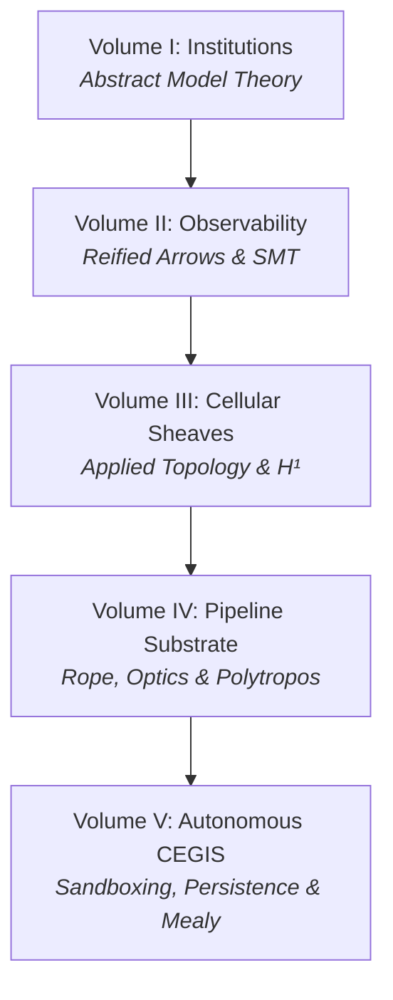

# Introduction & Architectural Framing

Welcome to **Gargamelle: Mathematical Foundations & Autonomous Synthesis**, the 5-volume treatise examining the intersection of categorical model theory, applied algebraic topology, observable verification, and autonomous program synthesis.

---

## 1. The Core Problem: Why Autonomous Synthesis Requires Higher Mathematics

Modern automated software synthesis and AI-driven code repair frequently degenerate into ungrounded text guessing. LLMs and black-box neural code generators propose edits without a formal semantics of the interfaces they bridge, without structural knowledge of multi-module architectural boundaries, and without guarantees that passing local tests does not introduce silent system-wide regressions.

Gargamelle addresses this epistemic deficit by constructing a multi-tier Haskell verification engine founded on five mathematical disciplines:
1. **Goguen-Burstall Categorical Institutions:** Truth invariance across heterogeneous languages and non-invasive pushout aspect weaving ($B \amalg_C W$).
2. **Reified Observability:** Complete elimination of opaque function closures `(a -> b)`, replacing them with introspectable arrow ASTs ([`ObsMor`](../../../packages/gargamelle-logic/src/Gargamelle/Logic/Defunctionalize.hs) ([Hackage](https://hackage.haskell.org/package/gargamelle-logic/docs/Gargamelle-Logic-Defunctionalize.html#t:ObsMor))) and free verifier trees.
3. **Applied Algebraic Topology & Cellular Sheaves:** Translating software architecture into graded 1D cell complexes and computing cohomological obstructions ($H^1(G; \mathcal{F})$) along failing module interfaces to guide targeted repair.
4. **Extensible Profunctor Pipeline Optics:** High-throughput Kernmantle arrow ropes, copy-on-write profunctor optics, and $O(1)$ variant routing.
5. **Grounded Linux Container Execution & Persistent Learning:** Bubblewrap namespace containment (`/usr/bin/bwrap`), Beam SQLite transaction recording, and formally verified Crem Mealy automata.

---

## 2. Package Cluster Architecture & Consumer Perspectives

The 5 volumes correspond directly to functional clusters of Gargamelle packages:

| Volume | Package Cluster | Mathematical & Systems Foundation |
| :--- | :--- | :--- |
| **Vol. I** | [`gargamelle-core`](../../../packages/gargamelle-core/README.md) ([Hackage](https://hackage.haskell.org/package/gargamelle-core)) | Abstract Model Theory, Institutions, Pushout Amalgamation |
| **Vol. II** | [`gargamelle-logic`](../../../packages/gargamelle-logic/README.md), [`gargamelle-model`](../../../packages/gargamelle-model/README.md), [`gargamelle-fol`](../../../packages/gargamelle-fol/README.md) | Category of Observable Morphisms, Free Verifiers, Streaming SMT Pipes |
| **Vol. III** | [`gargamelle-sheaf`](../../../packages/gargamelle-sheaf/README.md) ([Hackage](https://hackage.haskell.org/package/gargamelle-sheaf)) | Graded Cell Complexes, Cellular Sheaves, Store Comonad, Cohomology $H^1$ |
| **Vol. IV** | [`gargamelle-effect`](../../../packages/gargamelle-effect/README.md), [`polytropos`](https://github.com/nadia-chambers/polytropos) | Kernmantle Arrow Rope, Polytropos Flat Memory `Rep`, $O(1)$ Jump Tables |
| **Vol. V** | [`gargamelle-sandbox`](../../../packages/gargamelle-sandbox/README.md), [`gargamelle-persistence`](../../../packages/gargamelle-persistence/README.md), [`gargamelle-workflow`](../../../packages/gargamelle-workflow/README.md) | Bubblewrap Containers, Beam SQLite Evidence, Crem Mealy State Machines |

### The Reference Consumer: `sarutahiko`

Throughout this treatise, **`sarutahiko`** serves as our primary reference consumer and motivating exemplar. `sarutahiko` is an autonomous AI agent orchestration substrate that utilizes Gargamelle's categorical institutions to model multi-language codebases, its observable morphisms to synthesize provable specifications, and its cellular sheaves to evaluate multi-module consensus. 

At the same time, Gargamelle maintains rigorous modular uncoupling: any symbolic compiler, distributed contract engine, or automated bug-finding tool can instantiate these packages independently.

---

## 3. Tripartite Interlinking Mesh

This textbook operates as an integral layer of the **Tripartite Interlinking Mesh**:
- **Source Code:** Deep in-code GHC Notes (e.g. `Note [Goguen-Burstall Categorical Institution Satisfaction Invariance]` [ref:note-institution-satisfaction-invariance]) reference textbook theory.
- **Hackage/Haddock:** Exported types and typeclasses link to the online API portal.
- **Textbook:** Every theoretical section provides side-by-side **dual links** connecting abstract theorems to production Haskell definitions.

Consult [The Dual-Link Convention](dual-linking.md) to understand how to navigate this mesh.
