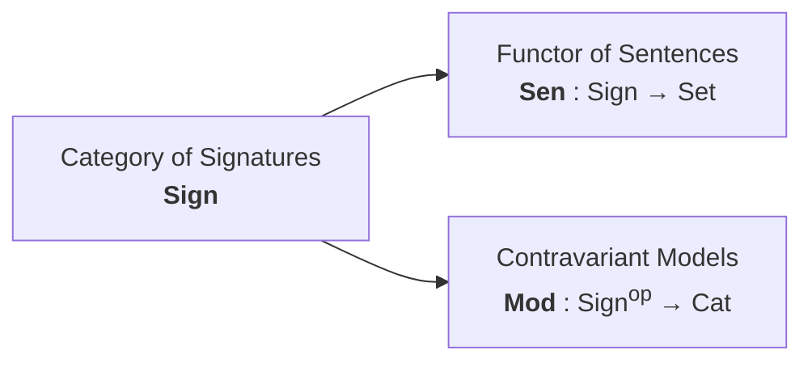

# Volume I: Abstract Model Theory & Categorical Institutions

**Core Package:** [`packages/gargamelle-core`](../../../../packages/gargamelle-core/README.md) ([Hackage](https://hackage.haskell.org/package/gargamelle-core))  
**Exemplar Perspective:** How `sarutahiko` weaves cross-language module contracts without AST leakage.  
**General Consumers:** Multi-language verification testbeds, heterogeneous compilers, and formal ontology engines.

---

## Executive Summary

Volume I establishes the categorical foundations of Gargamelle. When verifying or synthesizing programs across diverse programming languages (e.g. Haskell, Rust, Python) and verification domains (e.g. SMT-LIB2, first-order logic, equational logic), hard-coding a single concrete syntax causes catastrophic coupling. 

Instead, Gargamelle grounds verification in the **Goguen-Burstall Theory of Institutions**, treating truth, signatures, sentences, and models as an invariant categorical quadruple:

$$(\mathbf{Sign}, \mathbf{Sen}, \mathbf{Mod}, \models)$$

---

## Chapters in Volume I

1. [Chapter 1: The Problem of Heterogeneous Logics](ch01-heterogeneous-logics.md) — Why hard-coding ASTs fails in autonomous multi-aspect synthesis.
2. [Chapter 2: Signatures, Sentences, and Models](ch02-signatures-sentences-models.md) — The categorical quadruple and the [`Institution`](../../../../packages/gargamelle-core/src/Gargamelle/Core/Institution.hs) ([Hackage](https://hackage.haskell.org/package/gargamelle-core/docs/Gargamelle-Core-Institution.html#t:Institution)) typeclass.
3. [Chapter 3: The Satisfaction Invariance Condition](ch03-satisfaction-invariance.md) — Truth preservation under signature morphisms and Note [Goguen-Burstall Categorical Institution Satisfaction Invariance] [ref:note-institution-satisfaction-invariance].
4. [Chapter 4: Institution Comorphisms](ch04-institution-comorphisms.md) — Stepwise translation pipelines and defunctionalized signature mapping ([`InstitutionComorphism`](../../../../packages/gargamelle-core/src/Gargamelle/Core/Institution.hs) ([Hackage](https://hackage.haskell.org/package/gargamelle-core/docs/Gargamelle-Core-Institution.html#t:InstitutionComorphism))).
5. [Chapter 5: Pushout Feature Weaving](ch05-pushout-feature-weaving.md) — Non-invasive aspect composition $B \amalg_C W$ and Note [Categorical Pushout Feature Weaving] [ref:note-pushout-feature-weaving].
