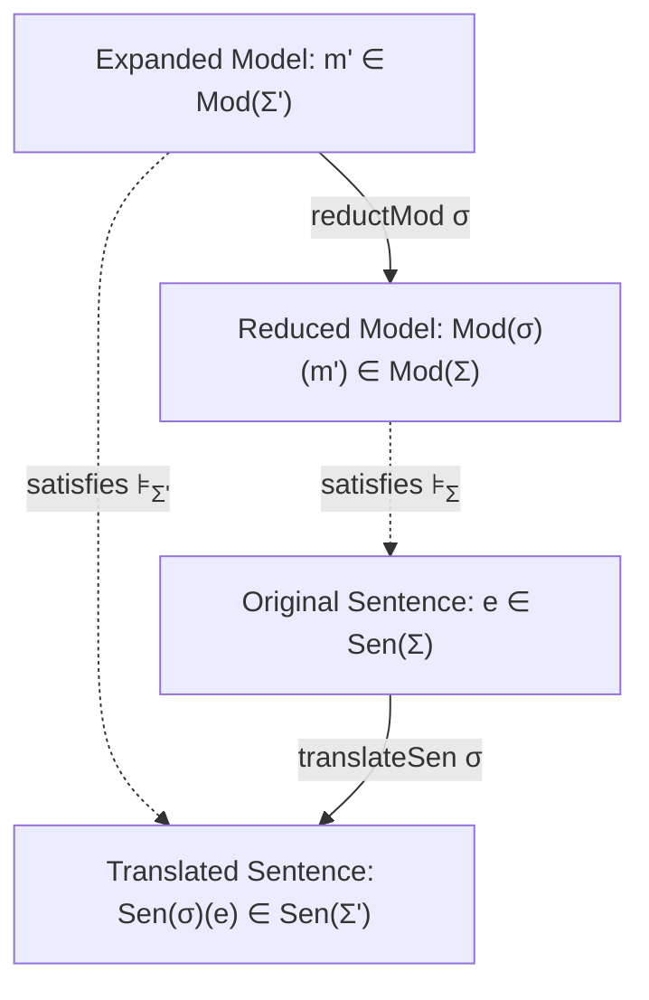

# Chapter 3: The Satisfaction Invariance Condition

**Volume I:** Abstract Model Theory & Categorical Institutions  
**GHC Note Invariant:** Note [Goguen-Burstall Categorical Institution Satisfaction Invariance] [ref:note-institution-satisfaction-invariance]

---

## 1. The Invariance Law

The quintessential axiom of institutional model theory is the **Satisfaction Invariance Condition**:

$$m' \models_{\Sigma'} \mathbf{Sen}(\sigma)(e) \iff \mathbf{Mod}(\sigma)(m') \models_{\Sigma} e$$

For any signature morphism $\sigma : \Sigma \to \Sigma'$, any model $m' \in |\mathbf{Mod}(\Sigma')|$, and any sentence $e \in \mathbf{Sen}(\Sigma)$:
- Truth is invariant under change of notation.
- Translating a specification along a signature morphism and verifying it in an expanded system is logically identical to evaluating the reduced model against the original specification.



---

## 2. In-Code Verification via Free Verifiers

In Gargamelle, satisfaction is not verified by uninspectable booleans. Instead, the satisfaction condition is verified by evaluating free verifier trees synthesized via [`satisfactionVerifier`](../../../../packages/gargamelle-core/src/Gargamelle/Core/Institution.hs) ([Hackage](https://hackage.haskell.org/package/gargamelle-core/docs/Gargamelle-Core-Institution.html#v:satisfactionVerifier)).

As formalized in Note [Goguen-Burstall Categorical Institution Satisfaction Invariance] [ref:note-institution-satisfaction-invariance], evaluating [`satisfactionVerifier`](../../../../packages/gargamelle-core/src/Gargamelle/Core/Institution.hs) ([Hackage](https://hackage.haskell.org/package/gargamelle-core/docs/Gargamelle-Core-Institution.html#v:satisfactionVerifier)) on the expanded model $m'$ and translated sentence $\mathbf{Sen}(\sigma)(e)$ yields identical evidence to running the verifier on $\mathbf{Mod}(\sigma)(m')$ and $e$:

```haskell:ignore
verifyExpanded :: (Institution i) => (Sig i -> Sig i) -> Sen i -> Mod i -> Evidence
verifyExpanded sigMorph sen modExpanded =
  let sen' = translateSen sigMorph sen
      vPlan = satisfactionVerifier sen'
  in runVerifier vPlan modExpanded
```

This ensures that autonomous agents like `sarutahiko` can project system-wide specifications onto localized component models without losing soundness.
