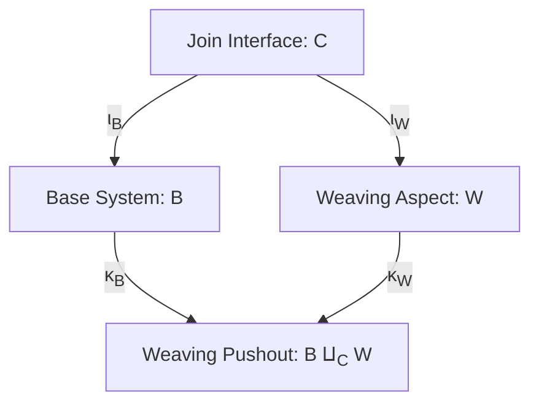

# Chapter 5: Pushout Feature Weaving

**Volume I:** Abstract Model Theory & Categorical Institutions  
**GHC Note Invariant:** Note [Categorical Pushout Feature Weaving] [ref:note-pushout-feature-weaving]  
**Production Type:** [`PushoutWeaving`](../../../../packages/gargamelle-core/src/Gargamelle/Core/Weaving.hs) ([Hackage](https://hackage.haskell.org/package/gargamelle-core/docs/Gargamelle-Core-Weaving.html#t:PushoutWeaving))

---

## 1. Non-Invasive Aspect Amalgamation

When synthesizing cross-cutting features (e.g. logging, authentication, caching, rate limiting) into a base module, traditional aspect-oriented programming mutates source code in place, causing brittle code churn and semantic regressions.

Categorical model theory solves this cleanly via **Pushout Feature Weaving**:

$$\begin{array}{ccc}
C & \xrightarrow{\iota_B} & B \\
\downarrow{\iota_W} & & \downarrow{\kappa_B} \\
W & \xrightarrow{\kappa_W} & B \amalg_C W
\end{array}$$

Where:
- $B$ is the base system signature.
- $W$ is the aspect or feature signature to be woven.
- $C$ is the shared join-point interface signature.
- $B \amalg_C W$ is the categorical pushout combining $B$ and $W$ over $C$.

---

## 2. Model Amalgamation in `gargamelle-core`

By the **Model Amalgamation Theorem**, whenever an institution satisfies the amalgamation property, any pair of compatible models $m_B \in |\mathbf{Mod}(B)|$ and $m_W \in |\mathbf{Mod}(W)|$ that agree on the shared interface:

$$\mathbf{Mod}(\iota_B)(m_B) = \mathbf{Mod}(\iota_W)(m_W)$$

uniquely amalgamate into a composite model $m_B \otimes m_W \in |\mathbf{Mod}(B \amalg_C W)|$.

This is mechanized via [`weaveAspect`](../../../../packages/gargamelle-core/src/Gargamelle/Core/Weaving.hs) ([Hackage](https://hackage.haskell.org/package/gargamelle-core/docs/Gargamelle-Core-Weaving.html#v:weaveAspect)) and [`PushoutWeaving`](../../../../packages/gargamelle-core/src/Gargamelle/Core/Weaving.hs) ([Hackage](https://hackage.haskell.org/package/gargamelle-core/docs/Gargamelle-Core-Weaving.html#t:PushoutWeaving)), enabling `sarutahiko` to weave telemetry and security policies into arbitrary services with mathematically certified non-interference.
