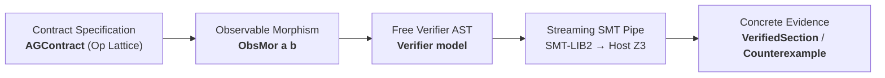

# Volume II: Reified Observability & Proof Synthesis

**Core Packages:** [`packages/gargamelle-logic`](../../../../packages/gargamelle-logic/README.md), [`packages/gargamelle-model`](../../../../packages/gargamelle-model/README.md), [`packages/gargamelle-fol`](../../../../packages/gargamelle-fol/README.md)  
**Exemplar Perspective:** How `sarutahiko` synthesizes verifiable specifications and streams typed SMT-LIB2 queries to host Z3.  
**General Consumers:** Symbolic verification pipelines, automated contract synthesizers, and certified program transformers.

---

## Executive Summary

Volume II tackles epistemic opacity in software engineering. In standard functional programming, computations are encapsulated in opaque function closures `(a -> b)`. These closures cannot be serialized, cannot be inspected without executing side-effects, cannot be translated to SMT-LIB2 for theorem provers, and cannot be compared for semantic equivalence.

Gargamelle replaces opaque closures with **100% Observable Morphisms** ([`ObsMor`](../../../../packages/gargamelle-logic/src/Gargamelle/Logic/Defunctionalize.hs) ([Hackage](https://hackage.haskell.org/package/gargamelle-logic/docs/Gargamelle-Logic-Defunctionalize.html#t:ObsMor))), first-order **Free Verifier Trees** ([`Verifier`](../../../../packages/gargamelle-model/src/Gargamelle/Model/Satisfaction.hs) ([Hackage](https://hackage.haskell.org/package/gargamelle-model/docs/Gargamelle-Model-Satisfaction.html#t:Verifier))), **Dual Assume-Guarantee Contracts** in inverted lattices ([`AGContract`](../../../../packages/gargamelle-logic/src/Gargamelle/Logic/Contract.hs) ([Hackage](https://hackage.haskell.org/package/gargamelle-logic/docs/Gargamelle-Logic-Contract.html#t:AGContract))), and direct streaming pipes to host **Z3 4.16**.

---

## Chapters in Volume II

1. [Chapter 1: The Tyranny of the Black Box](ch01-tyranny-of-closures.md) — Why opaque function closures destroy verification and learning.
2. [Chapter 2: Observable Morphisms (ObsMor)](ch02-observable-morphisms.md) — The category of introspectable arrows with `Strong` and `Choice` instances.
3. [Chapter 3: The Free Verifier AST](ch03-free-verifier-ast.md) — First-order `Divisible` and `Decidable` trees producing concrete evidence.
4. [Chapter 4: Dual Assume-Guarantee Contracts](ch04-dual-ag-contracts.md) — Inverting lattices via `Algebra.Lattice.Op` and circular soundness proofs.
5. [Chapter 5: The Host SMT Pipe](ch05-host-z3-smt-pipe.md) — Generating typed SMT-LIB2 and extracting SAT models from Z3.
