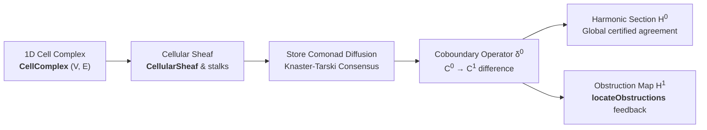

# Volume III: Applied Algebraic Topology & Cellular Sheaves

**Core Package:** [`packages/gargamelle-sheaf`](../../../../packages/gargamelle-sheaf/README.md) ([Hackage](https://hackage.haskell.org/package/gargamelle-sheaf))  
**Exemplar Perspective:** How `sarutahiko` analyzes cross-module architectural boundaries and localizes failing interface contracts.  
**General Consumers:** Distributed consensus protocols, topology-aware network monitors, and modular fault analyzers.

---

## Executive Summary

Volume III introduces cellular sheaves as an operational engineering discipline for distributed systems and modular software architectures. A software system consists of localized components (modules, functions, microservices) connected across shared interface boundaries (APIs, IPC channels, network sockets).

Gargamelle formalizes software architecture as a **1-Dimensional Cell Complex** ([`CellComplex`](../../../../packages/gargamelle-sheaf/src/Gargamelle/Sheaf/Complex.hs) ([Hackage](https://hackage.haskell.org/package/gargamelle-sheaf/docs/Gargamelle-Sheaf-Complex.html#t:CellComplex))) and assigns contract states to cells via **Cellular Sheaves** ([`CellularSheaf`](../../../../packages/gargamelle-sheaf/src/Gargamelle/Sheaf.hs) ([Hackage](https://hackage.haskell.org/package/gargamelle-sheaf/docs/Gargamelle-Sheaf.html#t:CellularSheaf))). By evaluating the **Sheaf Coboundary Operator** $\delta^0 : C^0 \to C^1$, the system detects harmonic global sections ($H^0 = \ker \delta^0$) and computes cohomological obstructions ($H^1$) that pinpoint exact failing interface boundaries to guide automated repair.

---

## Chapters in Volume III

1. [Chapter 1: Software Architectures as Cell Complexes](ch01-architectures-as-cell-complexes.md) — Graded cell hierarchy, boundary maps, and incidence signs.
2. [Chapter 2: Cellular Sheaves & Stalk Assignments](ch02-cellular-sheaves-stalks.md) — Assigning contract stalks over cells and directional restriction maps.
3. [Chapter 3: The Store Comonad on Cell Complexes](ch03-store-comonad-diffusion.md) — Comonadic cellular space via `Control.Comonad.Store`.
4. [Chapter 4: Knaster-Tarski Consensus Diffusion](ch04-knaster-tarski-consensus.md) — Monotonic lattice diffusion and convergence to greatest lower bounds.
5. [Chapter 5: The Sheaf Coboundary Operator & H¹ Obstructions](ch05-coboundary-h1-obstructions.md) — Cohomological fault localization (`locateObstructions`) and the Model Amalgamation Theorem.
