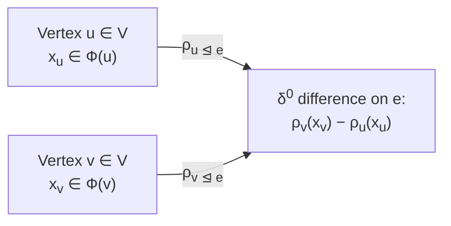

# Chapter 5: The Sheaf Coboundary Operator & H¹ Obstructions

**Volume III:** Applied Algebraic Topology & Cellular Sheaves  
**GHC Note Invariant:** Note [Sheaf Coboundary Operator and Cohomological Obstructions] [ref:note-sheaf-coboundary-obstructions]  
**Production Function:** [`locateObstructions`](../../../../packages/gargamelle-sheaf/src/Gargamelle/Sheaf/Cohomology.hs) ([Hackage](https://hackage.haskell.org/package/gargamelle-sheaf/docs/Gargamelle-Sheaf-Cohomology.html#v:locateObstructions))

---

## 1. The Coboundary Operator $\delta^0 : C^0 \to C^1$

In cellular sheaf cohomology, the 0-cochains $C^0(G; \mathcal{F}) = \prod_{v \in V} \mathcal{F}(v)$ represent global candidate assignments, while 1-cochains $C^1(G; \mathcal{F}) = \prod_{e \in E} \mathcal{F}(e)$ represent interface differences.

The **Coboundary Operator** $\delta^0$ computes the discrepancy across every 1-cell $e = (u, v)$:

$$(\delta^0 x)(e) = \rho_{v \trianglelefteq e}(x_v) - \rho_{u \trianglelefteq e}(x_u)$$



- When $\delta^0 x = 0$, $x$ belongs to the **0th Cohomology Group** $H^0(G; \mathcal{F}) = \ker \delta^0$. By the Model Amalgamation Theorem, $x$ constitutes a valid global section that amalgamates without conflict across the entire architecture.
- When $\delta^0 x \neq 0$, the non-zero cochains represent the **1st Cohomology Group** $H^1(G; \mathcal{F}) = C^1 / \operatorname{im} \delta^0$, pinpointing the topological obstructions to global agreement.

---

## 2. Pinpointing Regressions with `locateObstructions`

In [`Gargamelle.Sheaf.Cohomology`](../../../../packages/gargamelle-sheaf/src/Gargamelle/Sheaf/Cohomology.hs) ([Hackage](https://hackage.haskell.org/package/gargamelle-sheaf/docs/Gargamelle-Sheaf-Cohomology.html)), [`locateObstructions`](../../../../packages/gargamelle-sheaf/src/Gargamelle/Sheaf/Cohomology.hs) ([Hackage](https://hackage.haskell.org/package/gargamelle-sheaf/docs/Gargamelle-Sheaf-Cohomology.html#v:locateObstructions)) evaluates the coboundary operator over all edges:

```haskell:ignore
locateObstructions :: (Ord eId, Eq edgeStalk)
                   => CellularSheaf vId eId stalk edgeStalk
                   -> Map eId (edgeStalk, edgeStalk)
```

As detailed in Note [Sheaf Coboundary Operator and Cohomological Obstructions] [ref:note-sheaf-coboundary-obstructions], this mapping feeds directly into `sarutahiko`'s autonomous CEGIS loop, routing exact failing module interfaces back to code generation agents to direct targeted patch repair.
