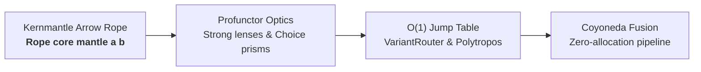

# Volume IV: Effectful Pipeline Architecture & Substrate Invariants

**Core Packages:** [`packages/gargamelle-effect`](../../../../packages/gargamelle-effect/README.md) ([Hackage](https://hackage.haskell.org/package/gargamelle-effect)), [`polytropos`](https://github.com/nadia-chambers/polytropos), [`kernmantle`](https://github.com/nadia-chambers/kernmantle)  
**Exemplar Perspective:** How `sarutahiko` executes high-throughput effectful Arrow Rope pipelines with zero-allocation variant jumps.  
**General Consumers:** High-performance data pipelines, extensible ADT engines, and low-latency stream processors.

---

## Executive Summary

Volume IV explores the execution substrate governing high-throughput symbolic manipulation in Gargamelle. When an autonomous synthesizer generates thousands of proof obligations, AST transformations, and subprocess runs, traditional monad transformer stacks (`ReaderT (StateT (ExceptT IO)))`) incur prohibitive allocation churn, cache thrashing, and uninspectable side-effects.

Gargamelle solves this using three coupled architectural innovations:
1. **The Kernmantle Arrow Rope:** Decoupling effect declaration from interpretation, enabling static config-time requirement analysis (`Requirements` mantle inspection) prior to execution.
2. **The Polytropos Substrate:** A single flat memory representation (`Rep`: a tag plus a flat `SmallArray` of payload slots) unifying records and variants.
3. **Constant-Time $O(1)$ Variant Routing & Coyoneda Fusion:** Replacing linear $O(n)$ case cascades with vector jump tables, and fusing pipeline stages without intermediate arrow allocations.

---

## Chapters in Volume IV

1. [Chapter 1: The Kernmantle Arrow Rope](ch01-kernmantle-arrow-rope.md) — Arrow composition and static config-time requirement analysis.
2. [Chapter 2: The Polytropos Substrate](ch02-polytropos-substrate.md) — Flat contiguous memory layouts for open products and sums.
3. [Chapter 3: Constant-Time O(1) Variant Routing](ch03-constant-time-variant-routing.md) — Unboxed tag jump tables and Note [Constant-Time O(1) Jump-Table Routing Physics] [ref:note-variant-jump-table-physics].
4. [Chapter 4: Profunctor Optics & Vectorized Updates](ch04-profunctor-optics.md) — Pure `Strong` lenses, `Choice` prisms, and copy-on-write thaw updates.
5. [Chapter 5: Coyoneda Pipeline Fusion](ch05-coyoneda-pipeline-fusion.md) — Eliminating intermediate wrapper allocations via pre-fused arrows.
