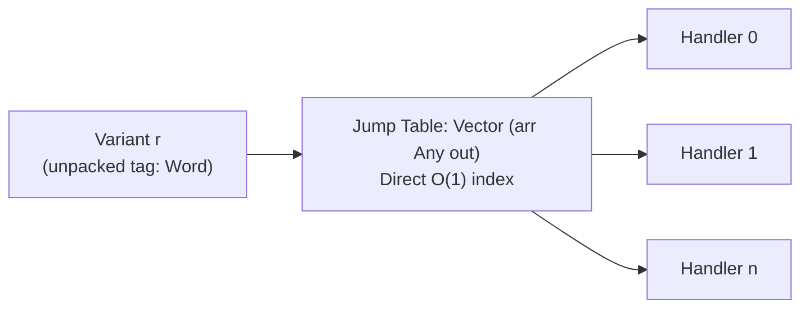

# Chapter 3: Constant-Time O(1) Variant Routing

**Volume IV:** Effectful Pipeline Architecture & Substrate Invariants  
**GHC Note Invariant:** Note [Constant-Time O(1) Jump-Table Routing Physics] [ref:note-variant-jump-table-physics]  
**Production Module:** [`Gargamelle.Effect.Router`](../../../../packages/gargamelle-effect/src/Gargamelle/Effect/Router.hs) ([Hackage](https://hackage.haskell.org/package/gargamelle-effect/docs/Gargamelle-Effect-Router.html))

---

## 1. Eliminating Case Cascades

When dispatching events in a large event-sourced architecture or Mealy state machine, branching on an open sum with 50 variants normally compiles to 50 linear `case` evaluations ($O(n)$ pointer tests and conditional branches).

As formalized in Note [Constant-Time O(1) Jump-Table Routing Physics] [ref:note-variant-jump-table-physics], [`Gargamelle.Effect.Router`](../../../../packages/gargamelle-effect/src/Gargamelle/Effect/Router.hs) replaces case cascades with unboxed vector jump tables:

```haskell:ignore
routeVariantWith :: VariantRouter arr r out -> arr (Variant r) out
```



---

## 2. Dispatch Mechanics

1. The input `Variant r` extracts its 0-indexed unboxed tag in 1 CPU instruction.
2. The router indexes into a flat `Vector (Any -> core out)` at offset `tag` with bounds checking.
3. The selected continuation arrow executes immediately.

This guarantees strictly bounded, constant-time dispatch latency regardless of how many hundreds of events or tool commands `sarutahiko` registers.
