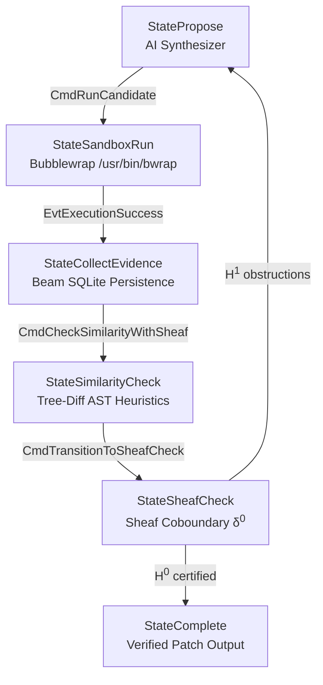

# Volume V: Grounded Verification & Autonomous CEGIS

**Core Packages:** [`packages/gargamelle-sandbox`](../../../../packages/gargamelle-sandbox/README.md), [`packages/gargamelle-persistence`](../../../../packages/gargamelle-persistence/README.md), [`packages/gargamelle-workflow`](../../../../packages/gargamelle-workflow/README.md)  
**Exemplar Perspective:** How `sarutahiko` runs fully autonomous patch synthesis campaigns without host contamination or regression loops.  
**General Consumers:** Automated code-repair bots, sandboxed evaluation harnesses, and database-backed learning loops.

---

## Executive Summary

Volume V culminates the treatise by grounding all preceding abstract mathematics into physical Linux execution environments and database-backed Counterexample-Guided Inductive Synthesis (CEGIS). 

Without physical execution sandboxing, AI-synthesized code can damage host filesystems, spawn fork bombs, or leak secrets. Without relational evidence persistence, synthesis algorithms repeat the same failing hypotheses in an infinite loop. And without formal state machine verification, synthesis loops can deadlock.

Gargamelle resolves these challenges through:
1. **Physical Namespace Sandboxing:** Bubblewrap (`/usr/bin/bwrap`) enforcing isolated mount, PID, IPC, and network namespaces with `/usr/bin/timeout`.
2. **Beam SQLite Evidence Persistence:** Relational tables ([`EvidenceRecordT`](../../../../packages/gargamelle-persistence/src/Persistence/Schema.hs), [`CounterexampleRecordT`](../../../../packages/gargamelle-persistence/src/Persistence/Schema.hs), [`RunRecordT`](../../../../packages/gargamelle-persistence/src/Persistence/Schema.hs)) tracking historical counterexamples across sessions.
3. **Verified Crem Mealy Automata:** Compile-time enforced state machine topology (`singletons-base`) preventing illegal loop transitions.
4. **The Complete Sheaf-Gated CEGIS Loop:** Integrating Z3, Bubblewrap, Beam, and Sheaf Cohomology into a single autonomous synthesis pipeline ([`runSheafGatedCEGIS`](../../../../packages/gargamelle-workflow/src/Workflow/Synthesis.hs) ([Hackage](https://hackage.haskell.org/package/gargamelle-workflow/docs/Workflow-Synthesis.html#v:runSheafGatedCEGIS))).

---

## Chapters in Volume V

1. [Chapter 1: Linux Container Namespace Isolation](ch01-bubblewrap-namespace-isolation.md) — Bubblewrap sandboxing boundaries, resource limits, and AppArmor unconfined profiles.
2. [Chapter 2: Grounded Evidence Persistence](ch02-grounded-evidence-persistence.md) — Beam SQLite relational schemas, transaction locking, and failure memory.
3. [Chapter 3: Formally Verified Mealy Automata](ch03-formally-verified-mealy-automata.md) — Compile-time topological verification via `crem` and `singletons-base`.
4. [Chapter 4: The End-to-End Sheaf-Gated CEGIS Loop](ch04-end-to-end-sheaf-cegis-loop.md) — Full pipeline integration, Knaster-Tarski diffusion, and repair feedback.
